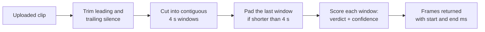
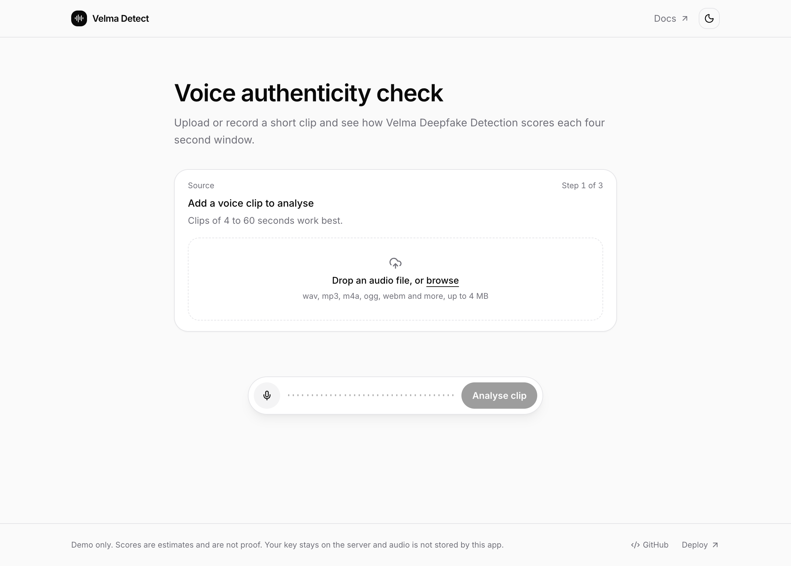
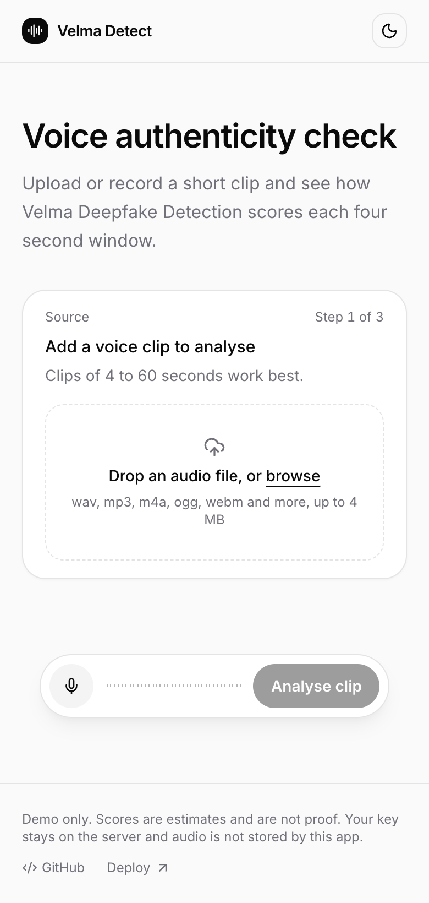
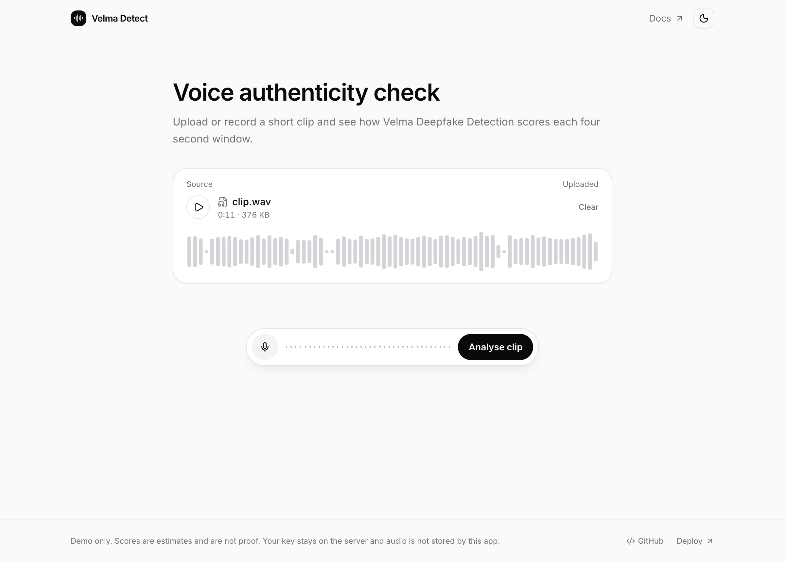
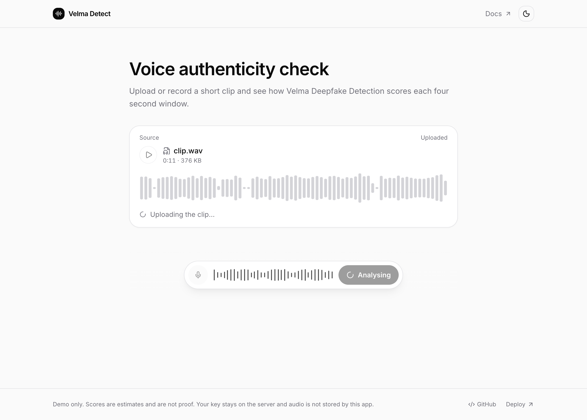
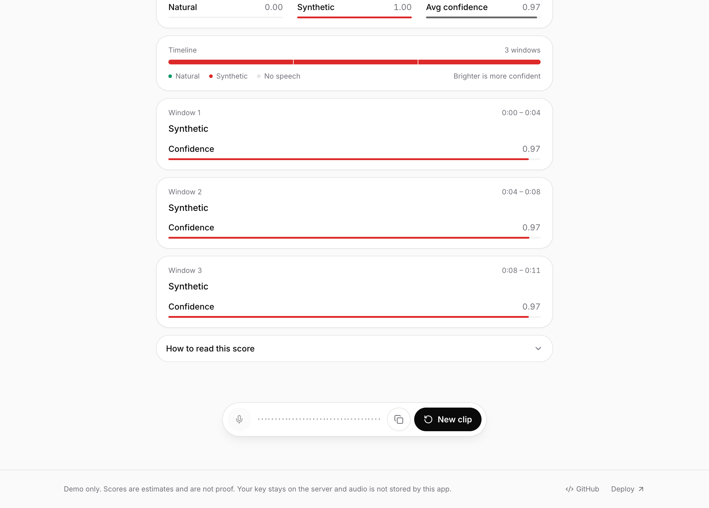
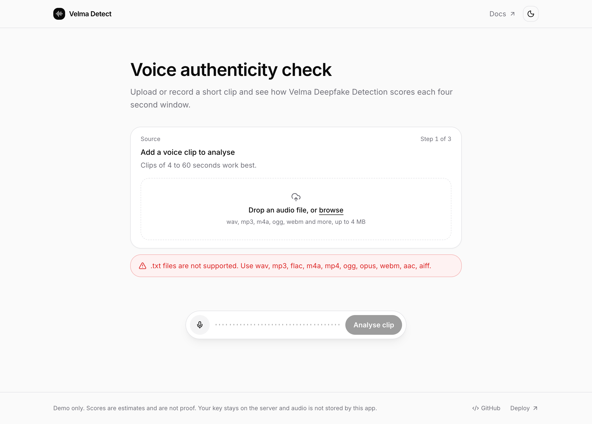

<p align="center">
  
</p>

# Velma Deepfake Detection Starter

A small Next.js app that sends a voice clip to Modulate's Velma Deepfake Detection API and shows what comes back. Upload a file, record from the microphone or pick a sample, press Analyse, and read the result on a meter with a plain label.

**This version analyses the clip after you finish. It does not stream live audio.** See [Batch or streaming](#batch-or-streaming) for why.

<p align="center">
  
</p>

The result screenshots use a clip made with the macOS text-to-speech voice, so the clip is synthetic by construction. They come from a real call to Velma, not mock data.

> Demo only. Scores are estimates and are not proof.

## Table of contents

- [Get started in three steps](#get-started-in-three-steps)
- [Run locally](#run-locally)
- [Environment variables](#environment-variables)
- [How it works](#how-it-works)
- [How a clip is split into windows](#how-a-clip-is-split-into-windows)
- [How the key is protected](#how-the-key-is-protected)
- [Metrics: natural, synthetic and confidence](#metrics-natural-synthetic-and-confidence)
- [From windows to a label](#from-windows-to-a-label)
- [Batch or streaming](#batch-or-streaming)
- [Limits and rate limiting](#limits-and-rate-limiting)
- [Add sample clips](#add-sample-clips)
- [Screenshots](#screenshots)
- [Project structure](#project-structure)

## Get started in three steps

1. **Get a key.** Request access at [platform.modulate.ai](https://platform.modulate.ai/signup-request) and create an API key in the dashboard.
2. **Deploy.**

   [](https://vercel.com/new/clone?repository-url=https%3A%2F%2Fgithub.com%2Fmodulate-ai%2Fdeepfake-detection-starter&env=VELMA_API_KEY&envDescription=Your%20Modulate%20Velma%20API%20key&envLink=https%3A%2F%2Fplatform.modulate.ai%2Fsignin)

3. **Open the app.** Choose a clip, press **Analyse clip**, read the result.

## Run locally

You need Node 22 and pnpm.

```bash
git clone https://github.com/modulate-ai/deepfake-detection-starter.git
cd deepfake-detection-starter
pnpm install
cp .env.example .env.local   # then paste your key after VELMA_API_KEY=
pnpm dev
```

Open <http://localhost:3000>.

Other scripts: `pnpm lint`, `pnpm exec tsc --noEmit`, `pnpm build`, `pnpm start`.

## Environment variables

| Name | Required | Description |
|---|---|---|
| `VELMA_API_KEY` | Yes | Your Modulate API key. Read on the server only. |

## How it works

```mermaid
%%{init: {"flowchart": {"nodeSpacing": 24, "rankSpacing": 36, "padding": 6, "wrappingWidth": 260, "htmlLabels": true}, "themeVariables": {"fontSize": "13px"}}}%%
flowchart LR
    classDef browser fill:#dbeafe,stroke:#2563eb,color:#0f172a
    classDef server fill:#e5e7eb,stroke:#4b5563,color:#0f172a
    classDef velma fill:#ede9fe,stroke:#7c3aed,color:#0f172a

    A["<b>1. Browser</b><br/>pick, drop or record"]:::browser
    B["<b>2. /api/detect</b><br/>validate, rate limit"]:::server
    C["<b>3. Velma batch</b><br/>4 s windows, score each"]:::velma
    D["<b>4. /api/detect</b><br/>summarise frames"]:::server
    E["<b>5. Browser</b><br/>verdict + timeline"]:::browser

    A -->|file| B
    B -->|upload_file| C
    C -->|frames| D
    D -->|summary| E
```



Blue steps run in the browser, grey steps on your server, purple steps at Velma. The server checks file type and size (max 4 MB) and applies a rate limit of 6 requests per minute per IP, adds the `X-API-Key` header, then drops no-content windows and computes the natural share, confidence and label. The browser never sees the API key and never talks to Velma directly.

The route calls the batch endpoint documented at [docs.modulate.ai/api-reference/svd/batch](https://docs.modulate.ai/api-reference/svd/batch?utm_source=github&utm_medium=repo&utm_campaign=infrasity_m1_repo2):

- [`POST https://platform.modulate.ai/api/velma-2-synthetic-voice-detection-batch`](https://platform.modulate.ai/api/velma-2-synthetic-voice-detection-batch?utm_source=github&utm_medium=repo&utm_campaign=infrasity_m1_repo2)
- Header `X-API-Key`
- Multipart field `upload_file`

Velma accepts `webm`, `ogg`, `opus`, `wav`, `mp3`, `m4a` and many other containers directly. Browser recordings (`webm` or `ogg`, depending on the browser) are therefore sent as they are, with no transcoding step.

## How the key is protected

- `VELMA_API_KEY` is read from `process.env` inside `app/api/detect/route.ts` and nowhere else.
- It has no `NEXT_PUBLIC_` prefix, so Next.js never bundles it for the browser.
- The key is never logged and never included in a response.
- `.env.local` is in `.gitignore`. Only `.env.example` with an empty value is committed.

## How a clip is split into windows

Velma does the splitting, not this app. The batch endpoint processes the file from start to finish in fixed **4 second windows** (its docs call them frames):



- Windows are back to back: `0:00 – 0:04`, `0:04 – 0:08`, `0:08 – 0:12` and so on. Timestamps refer to the original file, so trimmed silence does not shift them.
- Audio shorter than 4 seconds is padded before scoring. Velma needs at least 0.5 seconds, and 4 to 60 seconds is recommended.
- A window with no usable speech gets the verdict `no-content` with confidence `1.0`. This is assigned before the model runs, so silence is never guessed at.
- A 12 second clip of speech therefore yields about 3 windows. A 32 second clip with 16 seconds of speech can yield 8 windows, with the silent ones marked `no-content`.

The app shows one **window card** per frame (verdict, time range and confidence bar) and a **timeline** that lays the windows out in order. In the timeline each segment is as wide as its window, coloured by verdict, and brighter when Velma is more confident.

Source: [Velma Deepfake Detection docs](https://docs.modulate.ai/get-started/deepfake?utm_source=github&utm_medium=repo&utm_campaign=infrasity_m1_repo2).

## Metrics: natural, synthetic and confidence

Velma does not return a single fake score. Every window carries a **verdict** (`synthetic`, `non-synthetic` or `no-content`) and a **confidence** from 0 to 1 in that verdict. The app combines the windows into the metrics on the Verdict card.

| Metric | What it means | How it is computed |
|---|---|---|
| **Window verdict** | Velma's call for one 4 s window | Returned by Velma |
| **Window confidence** | How sure Velma is of *that verdict*, 0 to 1 | Returned by Velma |
| **Natural** | Share of detected speech judged `non-synthetic` | Time-weighted share over speech windows |
| **Synthetic** | Share of detected speech judged `synthetic` | `1 − Natural` |
| **Avg confidence** | Typical certainty across the clip | Time-weighted mean of window confidence over speech windows |
| **Speech seconds** | How much audio was actually scored | Sum of speech window lengths |

```text
speech      = windows whose verdict is not "no-content"
Natural     = Σ length(non-synthetic windows) / Σ length(speech windows)
Synthetic   = 1 − Natural
AvgConf     = Σ confidence × length / Σ length          (speech windows only)
```

### Confidence is not a fake score

Confidence says how certain Velma is about the verdict it gave. It is **not** the probability that the audio is synthetic.

- `non-synthetic` at `0.97` means Velma is 97% sure the speech is natural.
- `synthetic` at `0.97` means Velma is 97% sure the speech is synthetic. It does not mean "3% fake".
- That is why the first screenshot below reads **Natural 0.00, Synthetic 1.00, Avg confidence 0.97**: the clip is judged fully synthetic, and Velma is very sure about it.
- Avg confidence says nothing about direction. Read it together with Natural and Synthetic.

### Worked examples

| Clip | Windows (verdict @ confidence) | Natural | Synthetic | Avg confidence |
|---|---|---|---|---|
| Text-to-speech voice, 12 s | 3 × synthetic @ 0.97 | 0.00 | 1.00 | 0.97 |
| Real voice, 8 s | 2 × non-synthetic @ 0.92 | 1.00 | 0.00 | 0.92 |
| Mixed, 8 s | non-synthetic @ 0.90, synthetic @ 0.70 | 0.50 | 0.50 | 0.80 |
| 16 s of speech in a 32 s file | 4 × synthetic @ 0.97, 4 × no-content | 0.00 | 1.00 | 0.97 (silence excluded) |

The `no-content` windows never count towards Natural, Synthetic or Avg confidence. If every window is `no-content`, the app reports "No speech detected" instead of a score.

## From windows to a label

Modulate does not publish a clip-level threshold and advises setting one against your own labelled recordings. The cut-offs in [`lib/interpret.ts`](lib/interpret.ts) are demo defaults chosen for this repo, not Modulate values:

| Natural share of speech | Label |
|---|---|
| 75% or more | Likely real |
| Between 25% and 75% | Unsure |
| 25% or less | Likely synthetic |

Change `LIKELY_REAL_MIN` and `LIKELY_SYNTHETIC_MAX` to suit your data. The label uses only the Natural share. Confidence does not move a clip between labels, it is shown so you can judge how firm each call is.

Modulate publishes accuracy results for the model on the [Deepfake Detection benchmark page](https://docs.modulate.ai/benchmarks/deepfake-detection?utm_source=github&utm_medium=repo&utm_campaign=infrasity_m1_repo2). This repo does not make accuracy claims of its own.

## Batch or streaming

Velma offers both a batch endpoint and a WebSocket streaming endpoint. This starter uses batch because:

- The streaming endpoint takes the API key as a query parameter, so a browser connecting directly would expose the key.
- Next.js route handlers on Vercel cannot hold a WebSocket open, so a server-side proxy needs a separate long-running service.

If you need live scoring, run a small WebSocket relay on a host that supports it and keep the key there. The streaming reference is at [docs.modulate.ai/api-reference/svd/streaming](https://docs.modulate.ai/api-reference/svd/streaming?utm_source=github&utm_medium=repo&utm_campaign=infrasity_m1_repo2).

## Limits and rate limiting

| Limit | Value | Where it comes from |
|---|---|---|
| Upload size in this demo | 4 MB | Vercel rejects request bodies over 4.5 MB. Velma itself allows 100 MB. |
| Recording length | 30 seconds | Keeps recordings well under the size cap. |
| Clip length | 0.5 seconds minimum, 4 to 60 seconds recommended | Velma docs |
| Requests per IP | 6 per minute | `lib/rate-limit.ts`, in memory |
| Request timeout | 45 seconds | `lib/velma.ts` |
| Concurrent requests per key | 3 by default | Velma, per model, can be raised by Modulate |

The in-memory limiter keeps one counter per server instance. On serverless hosts each instance counts separately, so treat it as a courtesy limit. For production use a shared store such as Redis.

Errors from Velma are mapped to plain messages: 401 and 403 (key problems), 413 (too large), 422 (too short), 429 (concurrency or credits), 504 (timeout).

## Add sample clips

The sample picker reads `public/samples/manifest.json`. It ships as an empty array, so the picker is hidden until you add clips.

1. Put audio files in `public/samples/`.
2. Add an entry to `manifest.json` for each one:

```json
[
  {
    "title": "Studio voice, real",
    "file": "real-01.wav",
    "label": "real",
    "source": "https://example.com/where-it-came-from",
    "licence": "CC BY 4.0"
  }
]
```

Only add clips you recorded yourself or whose licence allows public redistribution. Keep them under 15 seconds.

## Screenshots

| Desktop | Mobile |
|---|---|
|  |  |

The flow, from choosing a clip to the result list, and the error state for an unsupported file:






## Project structure

```text
deepfake-detection-starter/
├── app/
│   ├── api/detect/route.ts     server route: validate, rate limit, call Velma, summarise
│   ├── layout.tsx              fonts and theme
│   ├── page.tsx                header, hero, detector, footer
│   └── globals.css             Tailwind and colour tokens (light and dark)
├── components/
│   ├── detector.tsx            upload/record, control pill, verdict, timeline, window cards
│   ├── waveform.tsx            SVG waveform and the dotted voice bar
│   ├── theme-toggle.tsx        light and dark switch
│   └── ui/                     shadcn/ui primitives (button, card, collapsible)
├── lib/
│   ├── velma.ts                endpoint, allowed formats, limits, response types
│   ├── interpret.ts            windows to Natural, Synthetic, confidence and label
│   ├── rate-limit.ts           in-memory per-IP limiter
│   ├── audio.ts                waveform decoding and recording helpers
│   └── utils.ts                class name helper
├── public/samples/             manifest.json and your sample clips
├── docs/screenshots/           UI screenshots used in this README
├── assets/banner.png           README banner
├── .env.example                VELMA_API_KEY placeholder
└── LICENSE                     MIT
```

## Links

- [Velma Deepfake Detection docs](https://docs.modulate.ai/get-started/deepfake?utm_source=github&utm_medium=repo&utm_campaign=infrasity_m1_repo2)
- [Authentication and rate limits](https://docs.modulate.ai/guides/authentication?utm_source=github&utm_medium=repo&utm_campaign=infrasity_m1_repo2)

Released under the [MIT licence](LICENSE).
